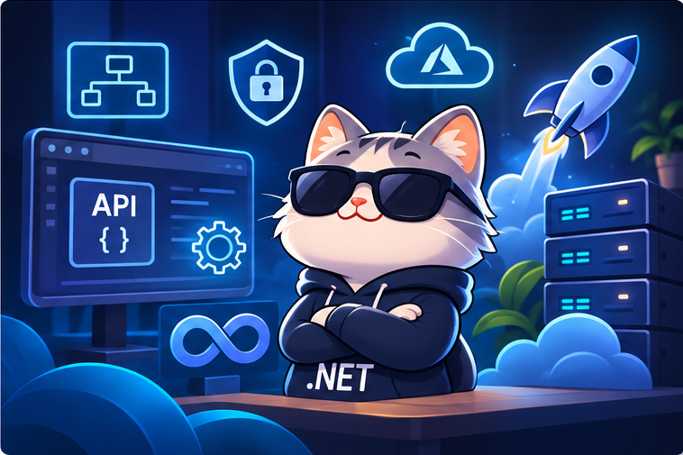

# Advanced Level

  

Welcome to the Advanced Level! In this stage, you will dive deeper into software design, testing, ASP.NET Core, and advanced backend development concepts.

The goal is to strengthen your understanding of building scalable, maintainable, and production-ready backend applications.

---

## 1. Design Patterns

**Note:** You can choose any ONE of the available learning resources.

| Resource | Notes |
|---|---|
| [Esam](https://www.youtube.com/playlist?list=PL4n1Qos4Tb6STYkwXrOdYxj_dlGqzozZN) | |
| [Elmahdy](https://www.youtube.com/playlist?list=PLsV97AQt78NTrqUAZM562JbR3ljX19JFR) | |

### Metigator | Issam Abdelnabi

| Resource | Notes |
|---|---|
| [Design Patterns Course](https://www.metigator.com/) | Paid Course by Issam Abdelnabi |
| [Metigator Engineers Community](https://t.me/MetigatorEngineers) | Community |

---

## 2. Unit Testing

**Note:** You can choose any ONE of the available learning resources.

| Resource | Notes |
|---|---|
| [Esam](https://www.youtube.com/playlist?list=PL4n1Qos4Tb6RrQpmpGWALaE1PVvWR8d3A) | |
| [Elmahdy](https://www.youtube.com/playlist?list=PLsV97AQt78NS2O4QeWFVHOOALoehl22vU) | |

---

## 3. ASP.NET Core

**Note:** You can choose ONE of the available courses/resources for this topic.

### Elmahdy

| Resource | Notes |
|---|---|
| [ASP.NET Core – Elmahdy](https://www.youtube.com/playlist?list=PLsV97AQt78NQ8E7cEqovH0zLYRJgJahGh) | |

### Pluralsight

| Resource | Notes |
|---|---|
| [Pluralsight](https://www.pluralsight.com/) | |

### DevCreed | Elhelaly

| Resource | Notes |
|---|---|
| [.NET REST API](https://www.devcreed.net/courses/details/dotnet-rest-api) | Paid – Recommended |

### Metigator | Issam Abdelnabi

| Resource | Notes |
|---|---|
| [Explanatory Video](https://www.youtube.com/watch?v=2VraSFzBWj4) | |
| [Mastering ASP.NET Core: Concepts to Production-Ready APIs](https://metigator.teachable.com/p/mastering-asp-net-core-concepts-to-production-ready-apis/) | Paid Course by Issam Abdelnabi |
| [Metigator Engineers Community](https://t.me/MetigatorEngineers) | Community |

### ITI

| Resource | Notes |
|---|---|
| [ITI](https://www.youtube.com/playlist?list=PLNFDrRZdysFwoq6CpexoOMLqz5hjohoI3) | |

---

## 4. ASP.NET Core MVC

**Note:** You can choose ONE of the following four learning resources.

| Resource | Notes |
|---|---|
| [DevCreed &#124; Elhelaly – MVC Course](https://www.devcreed.net/courses/details/dotnet-mvc-course) | Paid |
| [Pluralsight](https://www.pluralsight.com/) | |
| [ITI](https://www.youtube.com/watch?v=x6TuKY4YMGo&list=PLNFDrRZdysFzmzqno6G1EoxhIKo5sKiwL) | |
| [DevCreed &#124; Elhelaly](https://www.youtube.com/watch?v=QPjp7kXvGsg&list=PL62tSREI9C-fqCIAWwBAfhoucD82mSOXp) | |

---

## 5. Additional Backend Topics

**Note:** The following topics are separate topics, most of which are covered in the recommended paid content. However, make sure to study them individually, especially if you're following free resources, as they may not cover all the topics in sufficient detail.

### Repository Pattern and Unit of Work

| Resource | Notes |
|---|---|
| [DevCreed &#124; Elhelaly](https://www.youtube.com/playlist?list=PL62tSREI9C-e6nQ47brLj00iSGddiee73) | |

### JWT Tokens

| Resource | Notes |
|---|---|
| [DevCreed &#124; Elhelaly – JWT Tokens](https://www.youtube.com/playlist?list=PL62tSREI9C-eYNE1Pyw0yv1tETs5V8WGd) | |
| [DevCreed &#124; Elhelaly – Refresh Tokens](https://youtube.com/playlist?list=PL62tSREI9C-foV0zXVpW_f0JNtTD6Wv2W&si=onSCNXb-ggnRHRYE) | |
| [Nesma AbdelMaboud – Crash Course](https://youtu.be/mQHxbGdfWCw?is=1CnYzS5g6BaW5LYR) | Crash Course |

**Important Note:** Make sure to study both topics: JWT and Refresh Tokens. Both are essential and should be covered.

### .NET Identity

**Note:** You can choose any ONE of the available courses. There's no need to watch them all.

| Resource | Notes |
|---|---|
| [RoCoding](https://www.youtube.com/playlist?list=PLOeFnOV9YBa4yaz-uIi5T4ZW3QQGHJQXi) | |
| [Kudvenkat](https://www.youtube.com/playlist?list=PL6n9fhu94yhVkdrusLaQsfERmL_Jh4XmU) | Videos 65–123 |
| [DevCreed &#124; Elhelaly](https://www.youtube.com/playlist?list=PL62tSREI9C-fnwdLjHVP9K9GSHg-r7dzR) | |
| [Nesma AbdelMaboud – Crash Course](https://youtu.be/mQHxbGdfWCw?is=1CnYzS5g6BaW5LYR) | Crash Course |

### Hosting & Deployment

#### DevCreed

| Resource | Notes |
|---|---|
| [DevCreed](https://www.youtube.com/watch?v=__2riOjLpoc&list=PL62tSREI9C-fSG5MW3ZnQYWvqmolhOrxX) | Easy Way |

#### The Real Hosting Resources

| Resource | Notes |
|---|---|
| [Hosting Resource 1](https://www.youtube.com/watch?v=h9K1NnqwUvE) | Hosting |
| [Hosting Resource 2](https://www.youtube.com/playlist?list=PLX1bW_GeBRhDkTf_jbdvBbkHs2LCWVeXZ) | Hosting |
| [Hosting Resource 3](https://www.youtube.com/watch?v=5abffC-K40c) | Hosting |

### SignalR Programming

**Note:** You can choose any ONE of the available courses. There's no need to watch them all.

| Resource | Notes |
|---|---|
| [Ahmed Sadek](https://www.youtube.com/playlist?list=PLpKgDC4jSbmcf2F1m53WmhiQZNmqUZoCb) | |
| [ITI](https://www.youtube.com/watch?v=mPNWhQw9_mQ&list=PLNFDrRZdysFzsNkZqVnqhRUc1vqNHZY_t) | |

### NoSQL Database Programming

| Resource | Notes |
|---|---|
| [Simply Explained](https://www.youtube.com/watch?v=0buKQHokLK8) | |
| [freeCodeCamp.org](https://www.youtube.com/watch?v=fv2-A5e-KHA) | |

### Working with Files

| Resource | Notes |
|---|---|
| [RoCoding](https://www.youtube.com/playlist?list=PLOeFnOV9YBa7hs4IXcDh8I20ySpic8-EE) | |

### Rate Limiting

| Resource | Notes |
|---|---|
| [Mohamed Lawand](https://www.youtube.com/watch?v=bOfOo3Zsfx0&ab_channel=MohamadLawand) | |

### Logging

| Resource | Notes |
|---|---|
| [Milan Jovanović](https://www.youtube.com/watch?v=nVAkSBpsuTk) | |

---

## 6. Recommended Books

- **Building Web APIs with ASP.NET Core** by Valerio De Sanctis
- **Murach's ASP.NET Core MVC**
- **Pro ASP.NET SignalR: Real-Time Communication in .NET with SignalR 2.1**

---

## Congratulations!

You've successfully completed the Advanced Level!

  <a href="../README.md">⬅️ Back to Main Roadmap</a>

