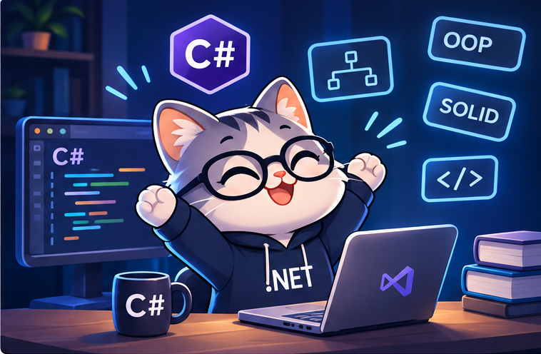

# Beginner Level

  

Welcome to the Beginner Level! In this stage, you will build a strong foundation in C# and Object-Oriented Programming (OOP), preparing yourself for the next steps in your .NET Backend journey.

---

## 1. C# Fundamentals, OOP & Advanced C#

**Note:** You can either follow one instructor's learning path and use their resources throughout C# Fundamentals, OOP, and Advanced C# topics, or mix and match resources from different instructors based on your preferences.

### Essam Abdelnaby

| Resource | Notes |
|---|---|
| [C# Fundamentals, OOP & Advanced C#](https://www.youtube.com/playlist?list=PL4n1Qos4Tb6SWPbJNpiznp-Ok4A8J_23l) | Covers C# Fundamentals, OOP, and Advanced C# |
| [OOP](https://www.youtube.com/watch?v=vo_vktaAK9o&list=PL4n1Qos4Tb6QqbzOaDvrEAW8C9LN9VSzj&pp=0gcJCR0Ga94AFGB0) | Additional resource to complement the roadmap |

### Mohamed Elmahdy

| Resource | Notes |
|---|---|
| [C# Fundamentals](https://www.youtube.com/playlist?list=PLsV97AQt78NT0H8J71qe7edwRpAirfqOI) | C# Fundamentals |
| [OOP](https://www.youtube.com/playlist?list=PLsV97AQt78NQumtM4rQc77yjbkZcGOTX5) | Object-Oriented Programming |
| [Advanced C#](https://www.youtube.com/playlist?list=PLsV97AQt78NQYhO7NqlBTrJX_Nsk3SmyY) | Advanced C# |

### Piece of Cake Dev

| Resource | Notes |
|---|---|
| [Level A](https://www.youtube.com/playlist?list=PLfHpC6JZ316dbrFn-jAwMBZwMqkcAabWB) | C# |
| [Level B](https://www.youtube.com/playlist?list=PLfHpC6JZ316f6YXKyux0dHjJXA0Kg38p7) | OOP |
| [Level C](https://www.youtube.com/playlist?list=PLfHpC6JZ316ciHMql4eXK1zfzuttajevf) | Advanced C# |
| [Level D](https://www.youtube.com/playlist?list=PLfHpC6JZ316dwb3MN8W6XuBuyaTA8RVaW) | Advanced C# |

### Ahmed Mamdouh – ITI

| Resource | Notes |
|---|---|
| [C# Fundamentals](https://www.youtube.com/watch?v=Qpgqls3KPv4&list=PLNFDrRZdysFxcO03JtQeIMed4GHFc2Yl&pp=0gcJCR0Ga94AFGB0) | C# Fundamentals |
| [OOP](https://www.youtube.com/watch?v=jZF0x_xer8M&list=PLNFDrRZdysFxO0fmABq8Ai9Lya-7-VK92) | Object-Oriented Programming |
| [Advanced C#](https://www.youtube.com/watch?v=kBxCFxOcoWw&list=PLYxGWFnJFttQqA5UPF2OoipOoDt4gXuXt&pp=0gcJCWYDOCosWNin) | Advanced C# |

### Metigator Paid Courses

| Resource | Notes |
|---|---|
| [Metigator – C# Bundle](https://www.metigator.com/) | Paid Courses: You can purchase Essam Abdelnaby's C# Bundle |
| [Metigator Engineers Community](https://t.me/MetigatorEngineers) | Community |

---

## 2. Coding Practice

**Note:** You can start practicing these 150 coding problems after completing C# Fundamentals, or gradually solve them while studying.

| Resource | Notes |
|---|---|
| [LeetCode – Top Interview 150](https://leetcode.com/studyplan/top-interview-150/) | 150 coding problems |

---

## 3. SOLID Principles

**Note:** You can choose either Essam Abdelnaby's or Elmahdy's resources. You don't need to study both.

### Essam Abdelnaby

| Resource | Notes |
|---|---|
| [SOLID Principles – Complete Course](https://www.youtube.com/playlist?list=PL4n1Qos4Tb6ThSyydEJTm7xJ3qEwE8Oyu) | Complete Course |
| [SOLID Principles – Workshop](https://www.youtube.com/watch?v=c_UnR7F900s) | Workshop |

### Mohamed Elmahdy

| Resource | Notes |
|---|---|
| [SOLID Principles – Complete Course](https://www.youtube.com/watch?v=bMT-pth4G20&list=PLsV97AQt78NRT1GmH2EJ-o-2_ILFM9feq) | Complete Course |

---

## 4. Recommended Books

- **Illustrated C# 7**
- **C# in a Nutshell** (Recommended)
- **Head First Design Patterns** (2nd Edition)
- **Clean Code** by Robert Cecil Martin

---

## Congratulations!

You've completed the Beginner Level and built a solid foundation in C# and programming fundamentals.

Keep going! Your next step is the **Intermediate Level**.

  <a href="../Intermediate/README.md"><strong>Go to Intermediate Level →</strong></a>

  <a href="../README.md">Back to Main Roadmap</a>

