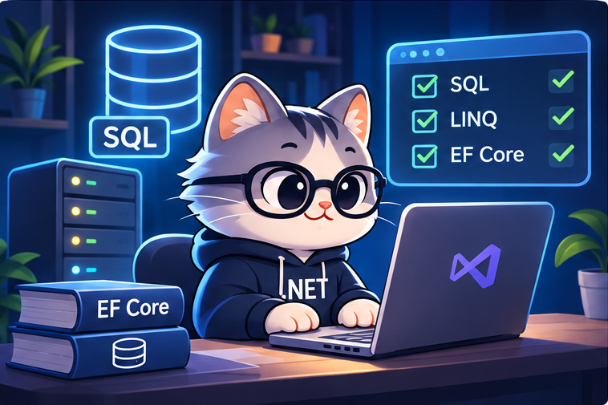

# Intermediate Level

  

Welcome to the Intermediate Level! In this stage, you will develop your understanding of databases and data management, and learn how to work with data efficiently using .NET technologies.

---

## 1. Database

**Note:** You can choose any ONE of the available resources.

### Mohamed El Desouky

| Resource | Notes |
|---|---|
| [Fundamentals](https://www.youtube.com/playlist?list=PL37D52B7714788190) | |
| [Advanced](https://www.youtube.com/playlist?list=PL1DUmTEdeA6J6oDLTveTt4Z7E5qEfFluE) | |

### Metigator | Issam Abdelnabi

| Resource | Notes |
|---|---|
| [Database Course](https://www.youtube.com/playlist?list=PL4n1Qos4Tb6RP_OovpgjoHLkCVaYFy-aj) | |

### MaharaTech

**Note:** These three courses are connected and designed to be studied sequentially. Each course builds on the knowledge gained from the previous one.

| Resource | Notes |
|---|---|
| [Course 1 – Basic Introduction](https://maharatech.gov.eg/course/view.php?id=740) | Very Basic Fundamentals |
| [Course 2 – Intermediate Fundamentals](https://maharatech.gov.eg/course/view.php?id=2305) | Builds on Course 1 |
| [Course 3 – Advanced Database Concepts](https://maharatech.gov.eg/course/view.php?id=2288) | Very Advanced |

### Metigator Paid Course

| Resource | Notes |
|---|---|
| [Database Course](https://www.metigator.com/) | Paid Course by Issam Abdelnabi |
| [Metigator Engineers Community](https://t.me/MetigatorEngineers) | Community |

### Database Internals (Optional)

| Resource | Notes |
|---|---|
| [Database Engines Crash Course](https://www.udemy.com/course/database-engines-crash-course/) | Optional |

### SQL Practice

**Note:** Here are 50 database practice problems to help you strengthen your SQL skills. Solve them at your own pace!

| Resource | Notes |
|---|---|
| [LeetCode – Top SQL 50](https://leetcode.com/studyplan/top-sql-50/) | 50 SQL practice problems |

---

## 2. LINQ

**Note:** You can choose any ONE of the available learning resources.

| Resource | Notes |
|---|---|
| [LINQ – Metigator &#124; Issam Abdelnabi](https://youtube.com/playlist?list=PL4n1Qos4Tb6Sj1Y4xJuJoWCuqleeG2yt6&si=XIE0NtaPXWU-ZKn4) | |
| [LINQ – Mohamed Elhelaly](https://www.youtube.com/playlist?list=PL62tSREI9C-c8OrLP_atJC_2PXqHKnUme) | |

---

## 3. Entity Framework Core (EF Core)

**Note:** You can choose either Metigator | Issam Abdelnabi's or Helaly's resources. However, if you choose Helaly's course, make sure to watch the first four videos from Metigator | Issam Abdelnabi's course as well.

| Resource | Notes |
|---|---|
| [EF Core – Metigator &#124; Issam Abdelnabi](https://www.youtube.com/playlist?list=PL4n1Qos4Tb6QZkbTWJx7wHqEABP8Pg6uv) | |
| [EF Core – Helaly](https://www.youtube.com/playlist?list=PL62tSREI9C-cHV28v-EqWinveTTAos8Pp) | |

---

## 4. Recommended Books

- **Head First SQL** by Lynn Beighley
- **LINQ in Action** by Fabrice Marguerie, Steve Eichert & Jim Wooley
- **Entity Framework Core in Action**

---

## Congratulations!

You've completed the Intermediate Level and gained a deeper understanding of databases and data management.

Keep pushing forward! Your next step is the **Advanced Level**.

  <a href="../Advanced/README.md"><strong>Go to Advanced Level →</strong></a>

  <a href="../README.md">⬅️ Back to Main Roadmap</a>

