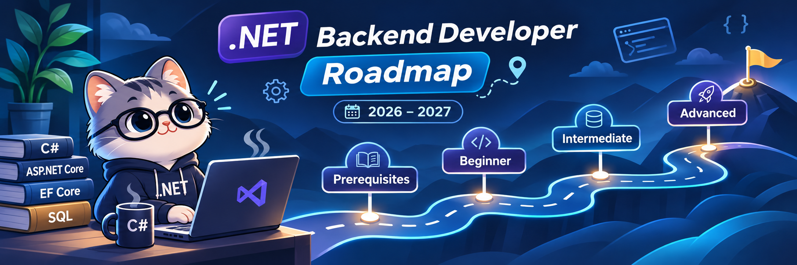
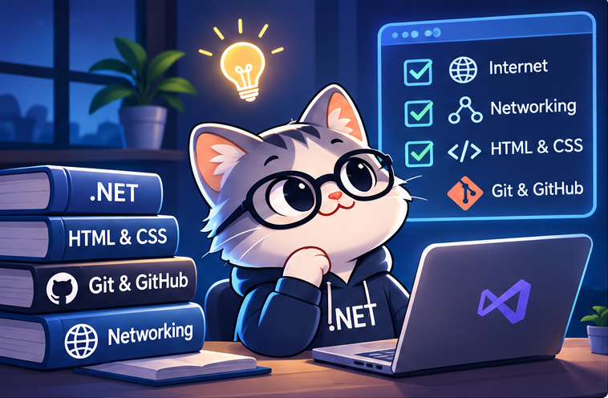
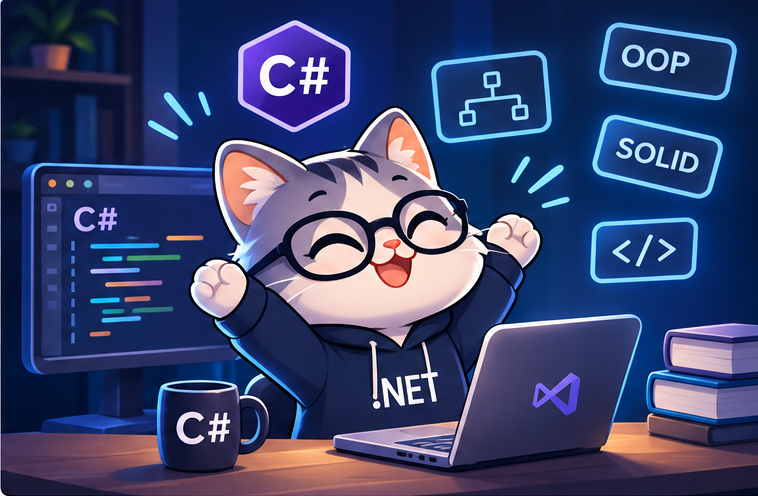
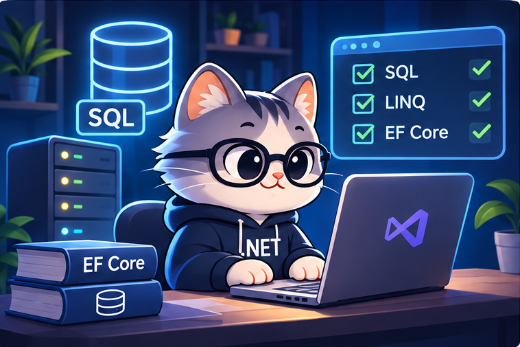
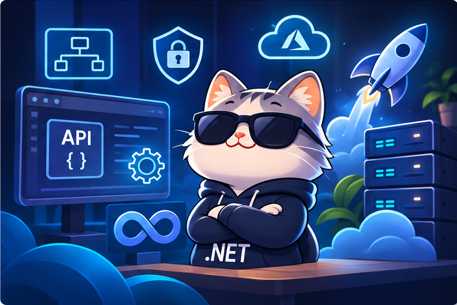
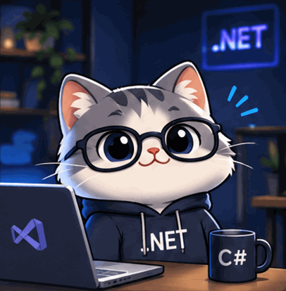

# .NET Backend Developer Roadmap 2026–2027

  

  <strong>Welcome to the CIS Team .NET Backend Roadmap!</strong>
   
  A structured learning path to becoming a professional .NET Backend Developer.

  

  <strong>2026 – 2027 | CIS Team</strong>

---

## About the Roadmap

This roadmap is designed to guide you through your journey toward becoming a **.NET Backend Developer**.

It provides a structured learning path with carefully selected resources and practical guidance to help you build the skills needed to develop scalable, maintainable, and production-ready backend applications.

Whether you're starting your journey or expanding your technical knowledge, this roadmap will help you progress step by step.

---

## Learning Path

The roadmap is divided into four stages. Start with the prerequisites and explore each level in order.

### Prerequisites

  

Prepare your foundation before starting the .NET Backend learning journey.

  <a href="./Prerequisites/README.md"><strong>Explore Prerequisites →</strong></a>

---

### Beginner Level

  

Build your programming foundation and start developing your skills with C#.

  <a href="./Beginner/README.md"><strong>Explore Beginner Level →</strong></a>

---

### Intermediate Level

  

Develop your understanding of databases and learn how to work with data efficiently using .NET.

  <a href="./Intermediate/README.md"><strong>Explore Intermediate Level →</strong></a>

---

### Advanced Level

  

Explore advanced backend development concepts and learn how to build scalable, maintainable, and production-ready applications.

  <a href="./Advanced/README.md"><strong>Explore Advanced Level →</strong></a>

---

## How to Use This Roadmap

1. **Follow the learning path:** Start with the Prerequisites and progress through the levels in order.
2. **Explore the resources:** Open each level to find its learning materials and recommendations.
3. **Practice regularly:** Apply what you learn through coding and practical exercises.
4. **Build projects:** Strengthen your skills by working on practical projects.
5. **Keep learning:** Explore documentation and stay updated with the .NET ecosystem.

---

## Our Goal

Our goal is to help aspiring backend developers build a solid technical foundation, develop practical skills, and become capable of designing and implementing real-world backend applications using **C# and .NET**.

---

## Your Journey Starts Here

Completing this roadmap is not the end of your journey. It's the beginning of a continuous learning experience.

.NET is a constantly evolving ecosystem, with always something new to learn, explore, and master. The more you practice and build real-world projects, the more experience you'll gain and the more concepts you'll discover.

Remember, this roadmap is your **first step**. Keep building, keep exploring, and never stop learning.

**Your journey as a .NET Backend Developer has just begun!**

---

  

  <strong>Thanks for being part of the journey!</strong>

---

## Connect

  
  

---

**Maintained by:** [Nesma AbdelMaboud](https://www.linkedin.com/in/nesma-abdelmaboud)

**CIS Team | 2026–2027**
